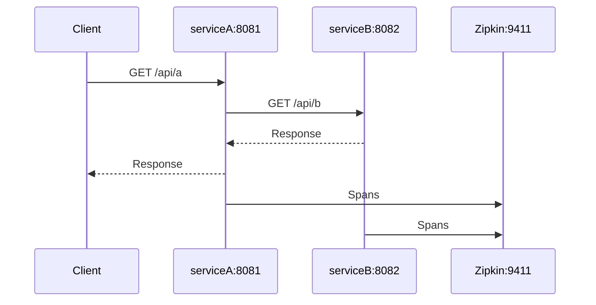

# Zipkin Learning Lab

Two-service Spring Boot demo for distributed tracing with Zipkin.

## Architecture



## Quick Start

```bash
docker compose up --build
curl http://localhost:8081/api/a
# Open http://localhost:9411 in browser
```

## Services

| Service | Port | Endpoint | Calls |
|---------|------|----------|-------|
| serviceA | 8081 | GET /api/a | serviceB |
| serviceB | 8082 | GET /api/b | - |
| Zipkin | 9411 | UI /api/v2/spans | - |

## Key Configuration

**application.properties (both services)**
```properties
spring.zipkin.base-url=http://zipkin:9411
management.zipkin.tracing.endpoint=http://zipkin:9411/api/v2/spans
management.tracing.sampling.probability=1.0
```

- `spring.zipkin.base-url` - Zipkin collector URL
- `management.tracing.sampling.probability=1.0` - 100% sampling (dev only, use lower in prod)

## Docker Network

All services share the `zipkin-lab` network, enabling hostname resolution:
- `serviceA` calls `http://serviceB:8082/api/b`
- Both services send traces to `http://zipkin:9411`

## Project Structure

```
.
├── docker-compose.yml
├── serviceA/
│   ├── Dockerfile
│   ├── pom.xml
│   └── src/main/
│       ├── resources/application.properties
│       └── java/com/youssef/servicea/
│           ├── ServiceAApplication.java
│           └── controller/ServiceAController.java
└── serviceB/
    ├── Dockerfile
    ├── pom.xml
    └── src/main/
        ├── resources/application.properties
        └── java/com/youssef/serviceb/
            ├── ServiceBApplication.java
            └── controller/ServiceBController.java
```

## Test the Trace

1. Run `docker compose up --build`
2. Call `curl http://localhost:8081/api/a`
3. Open Zipkin UI at `http://localhost:9411`
4. Click "Run Query" to see the trace spanning both services